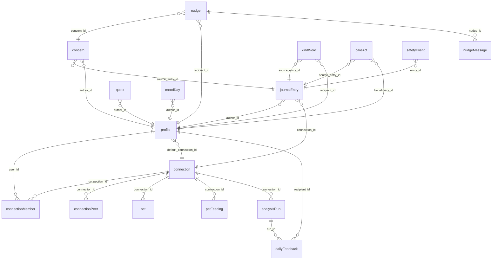

<!-- Generated from src/ontology by `npm run ontology:docs`. Edit the TypeScript, not this file. -->

# Yini ontology

Everything the app knows about, as three kinds of thing:

- **Objects**: the nouns. Each is a Zod schema with a doc string on every field, stored in one table.
- **Links**: typed relationships between objects, each backed by a foreign key.
- **Actions**: the verbs. Every API route is exactly one action, and the route validates its input and output against the action's schemas.

Source of truth: `frontend/src/ontology/`. One file per object in `objects/`, one per action in `actions/`, links in `links.ts`.
Regenerate these pages with `npm run ontology:docs` (in `frontend/`). The test suite fails when they are stale.

## Objects

| Object | Table | Who can read | Crosses boundary |
|---|---|---|---|
| [Analysis run](objects/analysisRun.md) | `analysis_runs` | server |  |
| [Care act](objects/careAct.md) | `care_acts` | server | yes |
| [Concern](objects/concern.md) | `concerns` | author | yes |
| [Connection](objects/connection.md) | `connections` | members |  |
| [Connection member](objects/connectionMember.md) | `connection_members` | members |  |
| [Connection peer (view)](objects/connectionPeer.md) | `connection_peers` | members | yes |
| [Daily feedback](objects/dailyFeedback.md) | `daily_feedback` | recipient | yes |
| [Journal entry](objects/journalEntry.md) | `entries` | author |  |
| [Kind word](objects/kindWord.md) | `kind_words` | recipient | yes |
| [Mood day](objects/moodDay.md) | `mood_days` | author |  |
| [Nudge](objects/nudge.md) | `nudges` | recipient | yes |
| [Nudge message](objects/nudgeMessage.md) | `nudge_messages` | recipient |  |
| [Pet](objects/pet.md) | `pets` | members |  |
| [Pet feeding](objects/petFeeding.md) | `pet_feedings` | members |  |
| [Pet state (derived)](objects/petState.md) | _derived_ | members |  |
| [Profile](objects/profile.md) | `profiles` | self |  |
| [Quest](objects/quest.md) | `quests` | author |  |
| [Safety event](objects/safetyEvent.md) | `safety_events` | server |  |

## Actions

| Action | Route | Actor |
|---|---|---|
| [Analyse now (admin)](actions/analyzeNow.md) | `POST /api/admin/analyze` | admin |
| [Check in](actions/checkIn.md) | `POST /api/checkin` | user |
| [Create connection](actions/createConnection.md) | `POST /api/connection` | user |
| [Demo login](actions/demoLogin.md) | `POST /api/demo/login` | public |
| [Get connection status](actions/getConnection.md) | `GET /api/connection` | user |
| [Get latest feedback](actions/getLatestFeedback.md) | `GET /api/feedback/latest` | user |
| [Get today](actions/getToday.md) | `GET /api/today` | user |
| [Join connection](actions/joinConnection.md) | `POST /api/connection/join` | user |
| [List my entries](actions/listEntries.md) | `GET /api/entries` | user |
| [List feedback](actions/listFeedback.md) | `GET /api/feedback` | user |
| [Run tonight's analysis now (demo)](actions/runMyAnalysis.md) | `POST /api/feedback/run` | user |
| [Nightly sweep (cron)](actions/runNightlySweep.md) | `GET /api/cron/nightly` | cron |
| [Transcribe audio](actions/transcribe.md) | `POST /api/transcribe` | user |

## Links

